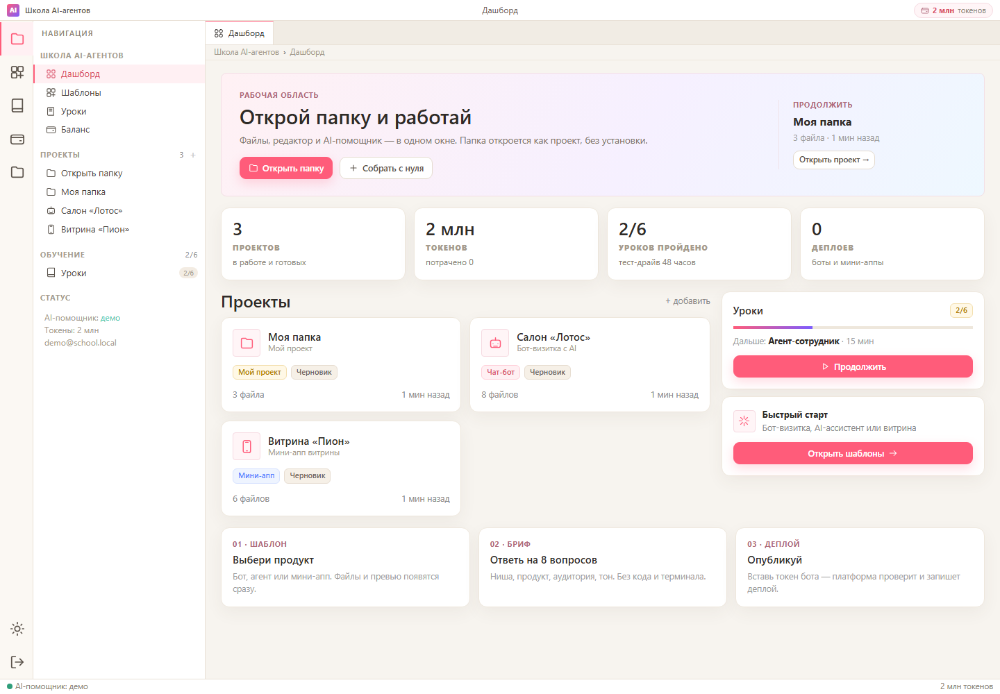

# Платформа «Школа AI-агентов» — MVP

Рабочий вертикальный срез: вход → шаблон → бриф → проект с файлами → чат с агентом → превью → деплой.

**Живая демо-ссылка:** https://school.91-184-242-178.sslip.io:8443
Basic Auth: `demo` / `school2026` · внутри платформы: `demo@school.local` / `demo1234`

Это постоянный деплой на сервере: Docker-контейнер + Caddy + HTTPS. Интерфейс — VS Code-подобный workbench: activity bar, проводник, вкладки, редактор с номерами строк, терминал и статус-бар. Подробности и обновление — [`deploy/README.md`](deploy/README.md).



## Быстрый старт

```powershell
cd C:\Users\NikSouk\Desktop\Proj\school-funnel\platform
python -m venv .venv
.\.venv\Scripts\Activate.ps1
pip install -r requirements.txt
copy .env.example .env
python -m uvicorn app.main:app --host 127.0.0.1 --port 8000
```

Откройте [http://127.0.0.1:8000](http://127.0.0.1:8000).

Проще на Windows: `.\run.ps1`.

**Демо-аккаунты**

- Ученик: `demo@school.local` / `demo1234`
- Админ: `admin@school.local` / `admin1234`

## Что уже работает

- Регистрация и вход, cookie-сессии, роли student/admin.
- **Профиль ученика**: имя, email, дата регистрации, баланс, последняя активность, история действий.
- **Аналитика в БД**: события `login/register/page_view/project_open/chat/file_save/deploy/lesson`; `last_seen_at`, DAU/WAU/MAU, активность за 7 дней, карточка пользователя.
- **Открыть папку с диска**: в Chrome/Edge — нативный выбор папки с доступом на запись, сохранения уходят и в облако, и в локальную папку.
- **Токенный баланс**: пакеты 1/5/10 млн, списание фактических токенов за запрос, история и счётчик.
- 7 шаблонов: боты, агенты, мини-аппы.
- **Светлая дружелюбная тема по умолчанию + тёмная VS Code-тема** переключателем в activity bar.
- Бриф из 8–11 полей → генерация файлов проекта.
- **DSH-агент**: реально читает/создаёт/меняет файлы, возвращает usage; mock остаётся fallback.
- **Живой стрим шагов** через SSE: «Задача принята», thinking, tool calls; Markdown-таблицы и блоки кода в чате.
- Дерево файлов, просмотр и редактирование, сохранение.
- **Рабочее окно**: ресайз AI-панели и терминала, drag-and-drop файлов, Markdown в чате, шаги/размышления DSH, Enter — отправить, Shift+Enter — новая строка, голосовой ввод (Chrome/Edge).
- Превью: эмулятор Telegram (кнопки работают), iframe мини-аппа, отчёт агента.
- Деплой: токен → Telegram `getMe` → статус и лог шагов.
- 6 уроков тест-драйва с прогрессом.
- Админка: люди, активность 1/7/30 дней, график событий, проекты, токены, маржа и карточка пользователя.

## Чего пока нет (следующий этап)

- 24/7-рантайм ботов (контейнеры, webhook, health-check).
- Платежи Robokassa/Stars (сейчас демо-пополнение).
- Мультитенантная изоляция и песочница на каждый проект.
- Live-слежение за внешними изменениями локальной папки.
- Маркетплейс шаблонов.

## Архитектура

```
platform/
  app/
    main.py       FastAPI: API, auth, SPA
    db.py         SQLite: схема, seed, events/analytics
    security.py   пароли, сессии, Fernet
    store.py      проекты, файлы, деплой, токены
    catalog.py    7 шаблонов + генерация файлов
    agent.py      DSH-headless + mock fallback
    telegram.py   getMe
    lessons.py    6 уроков
  static/
    index.html    SPA-оболочка
    app.js        роутер и экраны
    vscode.css    workbench
    theme-light.css  светлая тема
  data/
    platform.db   SQLite (не в git)
```

**Стек:** Python 3.11+, FastAPI, SQLite, httpx, cryptography, argon2, Node 22 + DSH. Фронтенд — vanilla JS без сборки.

## Агент

На сервере включён `AGENT_MODE=dsh`: DSH работает в отдельной папке проекта, меняет файлы, а платформа сохраняет дифф и списывает фактический usage. Без ключа/DSH автоматически включается mock.

```env
AGENT_MODE=dsh
DEEPSEEK_API_KEY=sk-...
DSH_BIN=dsh
DSH_HOME=/data/dsh
```

Адаптер пишет файлы проекта во временную папку, запускает `dsh --profile headless --json` и возвращает изменённые файлы. Сессии между ходами пока не переиспользуются — это следующий шаг.

## Деплой

1. Создайте бота в [@BotFather](https://t.me/BotFather).
2. Скопируйте токен.
3. В проекте нажмите «Опубликовать» и вставьте токен.
4. Платформа вызовет `getMe` и запишет деплой.

В MVP токен проверяется и хранится в зашифрованном виде (Fernet), но бот не поднимается на 24/7. Это честно написано в логе деплоя.

## Данные и сброс

Всё лежит в `data/platform.db`. Секрет для cookie и Fernet — в `data/.secret_key` (генерируется сам).

Сбросить демо:

```powershell
Remove-Item data\platform.db* -Force
# перезапустить сервер — база создастся заново
```

## Безопасность MVP

- Пароли — argon2 (fallback scrypt).
- Сессия — HttpOnly cookie, в базе только хеш токена.
- POST/PUT/DELETE проверяют Origin.
- Токены ботов шифруются, не попадают в логи и в ответы API.
- Файлы проекта ограничены 300 КБ, путь проверяется.
- Это **не продакшн**: нет HTTPS, WAF, мультитенантной изоляции и аудита.

## Проверка

Смоук-тест API (нужен запущенный сервер):

```powershell
python scripts/smoke_mvp.py
```

Скриншоты: [`docs/mvp/screenshots`](../docs/mvp/screenshots).

## Что дальше

1. Дать DeepSeek API key — включить реальный DSH-агент.
2. Дать тестовый токен бота — проверить деплой по-настоящему.
3. Поднять VPS + домен + HTTPS.
4. Контейнеры для ботов и мини-аппов.
5. Реальные платежи и пакеты токенов.
